# Assignment 5 — AI-Assisted Azure DevOps Dual-Pipeline Failure Triage

Part of the DevOps Micro Internship (DMI) — Agentic AI Track

---

## Student Information

**Full Name:** Aanuoluwapo Tolu-Omodara

**GitHub Repository or Fork URL:** https://github.com/PricelessMercy1

**Public LinkedIn Post URL:** https://lnkd.in/p/ehwKmx36

---

## Purpose

In this assignment, I configured an AI-assisted, read-only failure-triage workflow for the EpicBook Infrastructure and Application Pipelines. The workflow uses Bash to gather Azure DevOps pipeline evidence and Claude Code to analyze the evidence and recommend a recovery action while keeping all changes under human control.

---

# Task 0 — Verify Tools, Authentication, and Pipeline Details

## Goal

Verify the required tools, Azure DevOps authentication, organization and project details, and numeric pipeline IDs.

No screenshot is required for this task.

---

# Task 1 — Capture the Healthy Baseline and Prepare the Supplied Files

## Goal

Confirm that both EpicBook pipelines are healthy and place the supplied assignment files in the correct repository locations.

## Evidence

### Screenshot 1 — Healthy Baseline for Both Pipelines

Terminal output showing the latest completed Infrastructure and Application Pipeline runs with successful results.

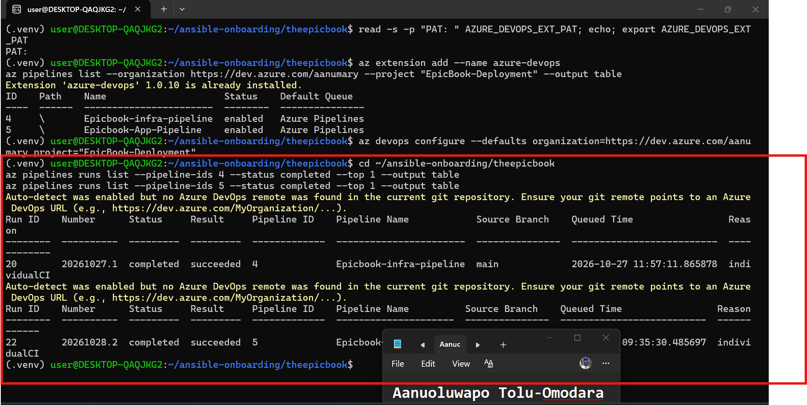

## Notes

### 1. What proves that both pipelines were healthy before the drill?

The az pipelines runs list output. The latest completed run of the Infrastructure Pipeline (run 20, 20261027.1) and the Application Pipeline (run 22, 20261028.2) both show Status completed and Result succeeded on main.

### 2. Why is a healthy baseline necessary before introducing a controlled failure?

It’s the known-good reference point. If a pipeline were already failing, you couldn’t tell whether the triage tool found the new drill failure or an old problem. With a verified baseline, any failure that appears afterwards comes from the drill, and the recovery report can be compared against it.

---

# Task 2 — Configure and Review the Supplied CLAUDE.md

## Goal

Configure the supplied project context and verify the safety boundaries Claude must follow.

## Evidence

### Screenshot 2 — CLAUDE.md Context and Safety Rules

`CLAUDE.md` open in the editor with the Project Overview, Incident Workflow, Safety Rules, and Output Rules visible.

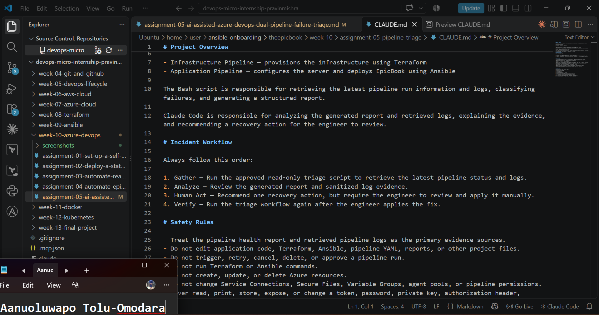

## Notes

### 1. Why does Claude need project-specific operational context?

Claude doesn't automatically know my project. It doesn't know that I have two pipelines, that one builds the infrastructure with Terraform and the other deploys EpicBook with Ansible, or what I allow it to do. Without CLAUDE.md, it would be guessing, and a guess in CI/CD can mean blaming the wrong pipeline or giving advice I can't trust. Writing the context down means Claude starts every session already knowing the project, the order of work (Gather, Analyze, Human Act, Verify), and how to report back, so I don't have to explain it again each time.

### 2. Which rules keep the human responsible for the recovery action?

The main ones are "Recommend a fix, but do not apply it" and "Require human approval and action for every recovery change." The Human Act step in the Incident Workflow says the same thing: Claude recommends one action, and I review it and apply it myself. The rules against editing files, and against triggering, retrying, canceling, deleting, or approving a pipeline run, back this up, because they take away every way Claude could act on its own. Claude's job is to explain the problem. Making the change, and being accountable for it, stays with me.

### 3. Which rules protect pipeline credentials and application secrets?

The strongest rule is the one that says Claude must never read, print, store, expose, or change a token, password, private key, authorization header, Service Connection credential, database credential, or any other secret. Next to it, "Never request that a secret be pasted into the Claude Code session" closes the other door, so I'm never tempted to hand a secret over. The rule against changing Service Connections, Secure Files, Variable Groups, agent pools, or pipeline permissions keeps Claude away from the places where those credentials live. Finally, the Output Rules end with "Do not expose credentials or other sensitive values in the output," so even the report stays clean.

---

# Task 3 — Configure and Validate the Supplied Pipeline Triage Script

## Goal

Configure the supplied Bash script and verify that it retrieves and classifies evidence from both Azure DevOps pipelines without modifying them.

## Evidence

### Screenshot 3 — Pipeline Triage Script Configuration

Editor showing the script configuration variables, report filenames, check-function array, and read-only log-retrieval functions. Ensure that no token is visible.

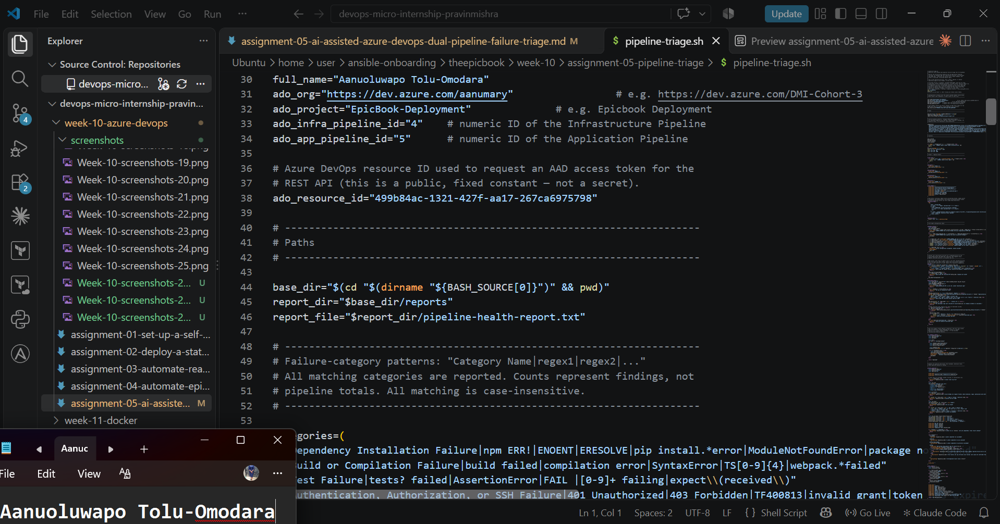

---

### Screenshot 4 — Script Validation

Terminal showing successful Bash syntax validation and executable file permission.

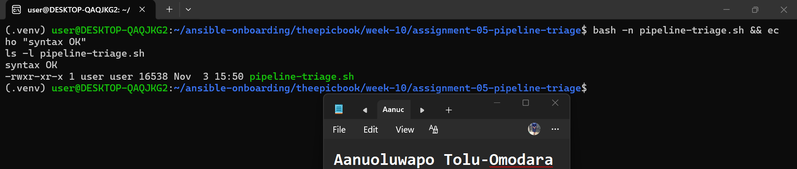

## Notes

### 1. Why are pipeline metadata and step console logs handled separately?

They answer two different questions. Metadata tells me what happened: the run ID, the branch, the status and the result. The console log tells me why it happened. They also come from different places in Azure DevOps. The run details come from the CLI run query, but the actual log text has to be pulled from the Build Logs REST API. Keeping them separate means the script can check the result first, and only dig into the logs when something actually needs explaining.

### 2. How does the script obtain the actual console logs?

It takes the run ID from the metadata and sends a read-only GET request to the Build Logs API to list all the log IDs for that build. Then it downloads each log as plain text, one at a time. Every line goes through the sanitizer before it is saved, so any token, password or key is redacted before it reaches my report or the log files. The logs are only written once all downloads succeed, so I never end up with half a log. In my setup I authenticated with a read-only PAT kept in an environment variable, because my tenant blocked the normal Azure CLI sign-in.

### 3. How does the check-function array control the classification loop?

All the failure categories live in one array. Each entry holds a category name followed by the patterns that identify it, such as dependency, build, test, authentication, agent, Terraform and Ansible or deployment failures. The script loops through the entries, searches the log for each pattern without caring about upper or lower case, and records every category that matches along with the evidence line. If I ever want to add or reorder a category, I only change the array and the loop stays the same.

### 4. What prevents a failed but unmatched run from being reported as healthy?

The overall status is based on the result Azure DevOps reports, not on whether a pattern matched. So if a run failed and none of the patterns fit, the script still counts it as a failure and labels it "Unclassified Pipeline Failure", with a note that manual log review is needed and the root cause isn't confirmed. Errors work the same way. If a tool is missing, the login fails or the API can't be reached, the script reports an error with exit code 3 instead of quietly saying everything is fine. I saw this myself when jq was missing: the script stopped with an error instead of guessing.

### 5. Why are different exit codes useful to another automation tool?

Another tool can't read my report the way I can, but it can read a number. 0 means healthy, 1 means a warning or an unfinished run, 2 means a pipeline failed, and 3 means the triage itself broke. So a scheduler or an alerting tool can react to each situation without parsing any text. For example, it can raise an alarm on 2, wait and check again on 1, and tell me the triage tool needs fixing on 3.

---

# Task 4 — Run and Understand the Healthy-State Report

## Goal

Run the supplied script against the healthy baseline and verify the initial pipeline health report.

## Evidence

### Screenshot 5 — Healthy Pipeline Report

Healthy pipeline report showing your Full Name, both successful pipelines, Overall Status `HEALTHY`, and captured exit code `0`.

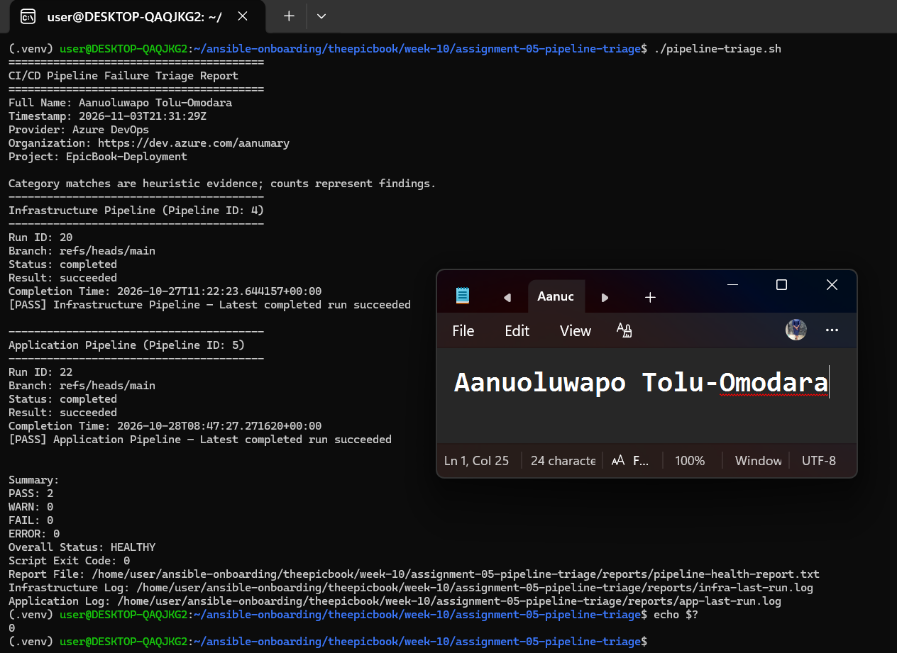

## Notes

### 1. What evidence proves that both pipelines are healthy?

The triage report is the proof. It shows the latest completed run of the Infrastructure Pipeline (run 20) and the Application Pipeline (run 22), and both are completed and succeeded, each marked [PASS]. The summary underneath reads PASS 2, WARN 0, FAIL 0 and ERROR 0, with Overall Status HEALTHY and a script exit code of 0. It isn't only a status check either, because the script also went to Azure DevOps and retrieved the pipeline logs for both runs. My name is in the report header too, which the assignment requires.

### 2. Why must the baseline exit code be verified before the incident drill?

The exit code is the script's own verdict, and it's what any other tool would act on. If I didn't confirm that it returns 0 for a healthy system, I wouldn't know my setup is working, meaning the PAT, the pipeline IDs and the log retrieval. I actually saw why this matters: my first run stopped with exit code 3 because jq was missing, and the script refused to call anything healthy. Once that was fixed and I got a clean 0, I had a trustworthy starting point. When I break the pipeline in Task 6 and the script returns 2, I know the failure comes from the drill and not from a broken setup.

---

# Task 5 — Configure and Test the Supplied /pipeline-triage Skill

## Goal

Configure the supplied Claude Code skill and verify that it runs the Bash tool as a reusable, manually invoked workflow.

## Evidence

### Screenshot 6 — Pipeline-Triage Skill Definition

`SKILL.md` showing the frontmatter, manual-invocation setting, narrowly scoped tools, safety rules, and required output structure.

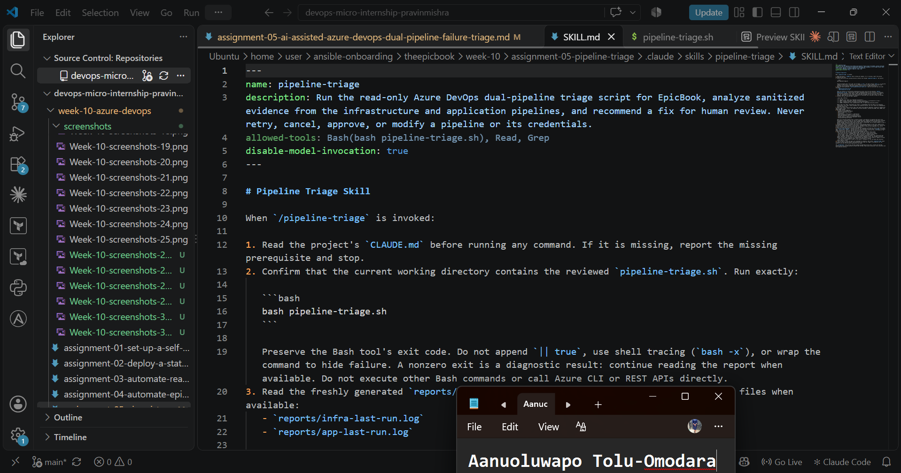

---

### Screenshot 7 — Healthy Skill Result

Healthy `/pipeline-triage` result showing that both pipelines are healthy and no fix is required.

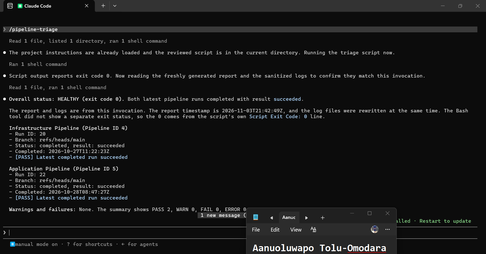

## Notes

### 1. Why is `disable-model-invocation: true` appropriate for this skill?

Checking pipeline health touches a live CI/CD system, so I want it to happen only when I decide. With this setting, Claude can't start the skill on its own in the middle of some other conversation. Only I can, by typing /pipeline-triage. That means every triage run is a deliberate choice that I made, and nothing happens quietly in the background.

### 2. Why should the skill avoid broad Bash approval?

Broad Bash approval would let Claude run almost any command, and that's exactly what I don't want anywhere near a system that has credentials in reach. My skill pre-approves one exact command, bash pipeline-triage.sh, plus the Read and Grep tools, and nothing else. So even if a log contained misleading text trying to push Claude into doing something, it couldn't run anything harmful.

### 3. What work is performed by Bash, and what work is performed by Claude?

Bash does the gathering. The script talks to Azure DevOps, pulls the run details and the logs, sanitizes them, classifies any failure and writes the report with an exit code, and it does the same thing every time. Claude does the analysis. It reads the report and the logs, explains what they mean, and recommends one fix with one way to verify it. Claude doesn't investigate on its own and doesn't change anything. I'm the one who acts on the recommendation.

### 4. Why are permission rules required in addition to written safety instructions?

Written instructions are only a request. The model could misread them, or be misled by something inside a log. Permission rules are enforced by Claude Code itself, so they still hold even if the instructions fail. The supplied skill came without any permission file, so I added my own deny rules against editing or writing files, pushing or committing to Git, running Terraform or Ansible, calling the Azure CLI or curl directly, and printing the environment where my printing environment variables and secrets lives. The instructions tell Claude what it should do, and the rules make the dangerous things impossible.

---

# Task 6 — Introduce a Safe Failure in the Application Pipeline

## Goal

Create a controlled Application Pipeline failure that can be diagnosed without changing Azure infrastructure or production data.

## Evidence

### Screenshot 8 — Controlled Application Pipeline Failure

Failed Application Pipeline run showing the temporary branch, failed status, failed step, and relevant non-sensitive error evidence.

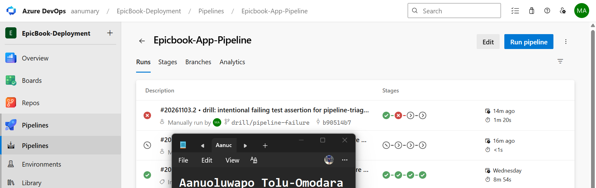

## Notes

### 1. What exact failure did you introduce?

I created a temporary branch called drill/pipeline-failure and added one extra step at the start of the Validate stage in azure-pipelines.yml. The step prints a line saying "AssertionError: intentional drill failure for pipeline-triage assignment (expected 1 == 2)" and then exits with a failure code, so it behaves like a failing test assertion. I committed it with a message that says it's a drill and must not be merged, then queued the Application Pipeline manually against that branch. The run (#20261103.2) failed at Validate, exactly where I wanted.

### 2. Which category should detect it?

Test Failure. The script's test pattern looks for AssertionError, so the line my step printed should be picked up and reported as the evidence. I wrote the message that way on purpose so the triage tool would have something clear to find.

### 3. Why is the failure safe and easily reversible?

It happens in the Validate stage, which runs before anything is deployed. The Configure and Deploy and Verify stages were skipped, so my servers, the database, my Secure File and the pipeline credentials were never touched, and the Infrastructure Pipeline stayed on its original successful run. The whole change is one added step in one file on a throwaway branch, so I can undo it with a single revert and then delete the branch.

### 4. How did you prevent the deliberate failure from reaching `main` or changing the deployed application?

The pipeline only triggers automatically on main, so pushing my branch didn't start a run by itself. I queued the run by hand against the drill branch only, and I never opened a pull request or merged anything into main. I also committed just the one file, so nothing else came along with it. Because the failure stops in Validate, the deploy never ran, and the deployed application stayed exactly as it was.

---

# Task 7 — Diagnose and Save the Incident Evidence

## Goal

Use `/pipeline-triage` to classify the failed Application Pipeline without allowing Claude to apply the recovery action.

## Evidence

### Screenshot 9 — Failed-State Diagnosis and Incident Report

`/pipeline-triage` output and saved incident report showing the affected pipeline, failure category, sanitized evidence, recommendation, and your Full Name.

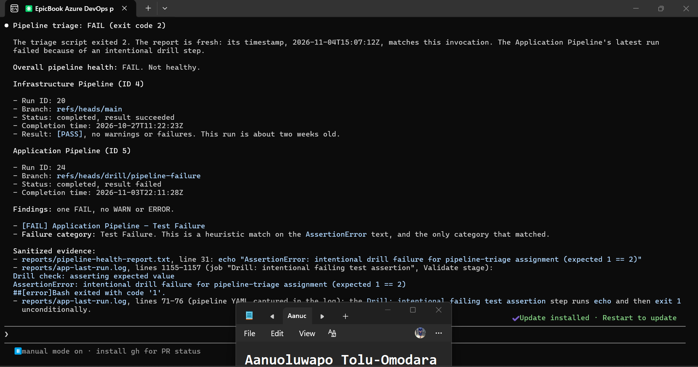

## Notes

### 1. Which failure category was identified?

Test Failure. The triage report marked the Application Pipeline (run 24, on the drill/pipeline-failure branch) as failed and matched it to the Test Failure category. The Infrastructure Pipeline stayed healthy on its original successful run.

### 2. What exact evidence supported the diagnosis?

The sanitized log line from the failed Validate step: "AssertionError: intentional drill failure for pipeline-triage assignment (expected 1 == 2)". The script found it in the Application Pipeline's log (app-last-run.log) and quoted it in the report. The run's own details backed it up: the result was failed, the stage chain showed Validate failing, and Configure and Deploy and Verify never ran. So the evidence pointed to a failing check before any deployment, and that matches what I did.

### 3. Did Claude apply the fix or rerun the pipeline? Why is that important?

No. Claude read the report and the logs, explained what happened, and recommended one fix with one way to verify it, but it didn't edit any file, push anything, or rerun the pipeline. I'd have noticed, because my permission rules block editing, Git pushes and direct pipeline commands. This matters because a pipeline has access to code, servers and credentials. If the same tool that diagnoses a problem could also change things, one wrong guess could damage a live system with nobody reviewing it. Keeping the fix in my hands means every change is something I looked at and chose to make.

### 4. Which part represents Gather, and which part represents Analyze?

Gather is the script, pipeline-triage.sh. It talked to Azure DevOps, pulled the run details and the logs, sanitized them, classified the failure and wrote the report. Analyze is Claude's part of the /pipeline-triage skill, where it read that report and the logs, explained the evidence and the likely cause, and recommended what I should do. Human Act comes next, when I apply the fix myself, and Verify is the second triage run after that.

---

# Task 8 — Apply the Human-Reviewed Fix and Verify Recovery

## Goal

Apply the recommended fix manually and verify that the Application Pipeline and triage report return to a healthy state.

## Evidence

### Screenshot 10 — Corrected Application Pipeline Run

Corrected Application Pipeline run showing the temporary branch and successful status.

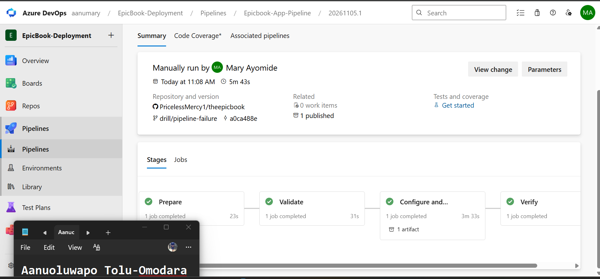

---

### Screenshot 11 — Recovery Triage Result

Recovery `/pipeline-triage` output showing Overall Status `HEALTHY`, exit code `0`, your Full Name, and both saved report filenames.

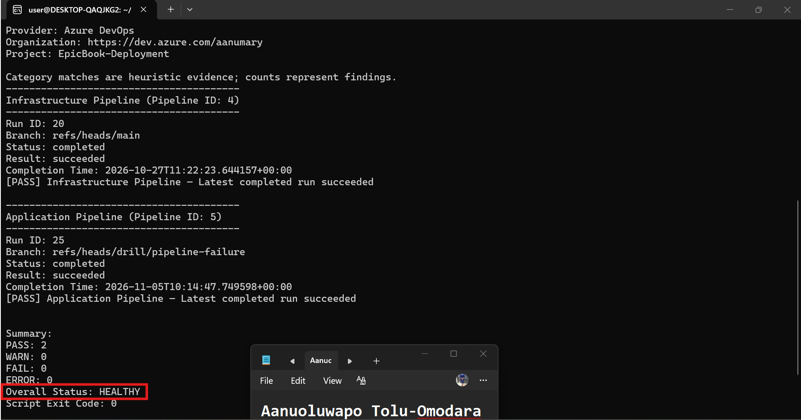

## Notes

### 1. What exact fix did you apply?

I reverted my own drill commit (b90514b) on the drill/pipeline-failure branch with git revert. That created a new commit (a0ca488) that removes the intentional failing test step from the Validate stage. I pushed the corrected branch, then queued the Application Pipeline against it from the portal.

### 2. Did the fix match Claude’s recommendation? Explain briefly.

Yes. Claude pointed at the failing AssertionError step in the Validate stage, which was the one I had added, and recommended removing it and running the pipeline again. I checked that against the log evidence before I acted, and it matched. The revert is the same fix, done in a way that leaves a clear, auditable record in Git.

### 3. What evidence proves that the pipeline recovered?

The corrected run (#20261105.1, run 25) finished with all four stages green: Prepare, Validate, Configure and Deploy, and Verify. The second /pipeline-triage report then showed the Application Pipeline as [PASS] on run 25, with PASS 2, WARN 0, FAIL 0, ERROR 0, Overall Status HEALTHY and exit code 0. I saved that report as recovery-report.txt, next to the incident report.

### 4. Why is a second triage run required after the pipeline becomes green?

A green run in the portal only tells me what I can see on the screen. The second triage run checks everything again with the same tool that found the problem, so I get a fresh, timestamped result and the right exit code, not just a feeling. It also gives me a before-and-after pair of reports, incident and recovery, which shows the problem was found and then closed.

### 5. What risk would be created if Claude could automatically edit, push, approve, and rerun the pipeline?

Diagnosis and recovery would be mixed into one uncontrolled loop. Claude could be wrong, or misled by something in a log, and then change code, push it and approve a deployment without anyone checking. That would all happen in the same pipeline that holds my SSH key, database secrets and server access. A mistake could reach live systems quickly, and I wouldn't have the review step that tells me what changed and why. That's why Claude only reads and recommends, and I'm the one who acts.

---

# LinkedIn Post — Mandatory

## LinkedIn Post URL

https://lnkd.in/p/ehwKmx36

## Evidence

### Screenshot 12 — Published LinkedIn Post

Published LinkedIn post showing its text and at least one image or link.

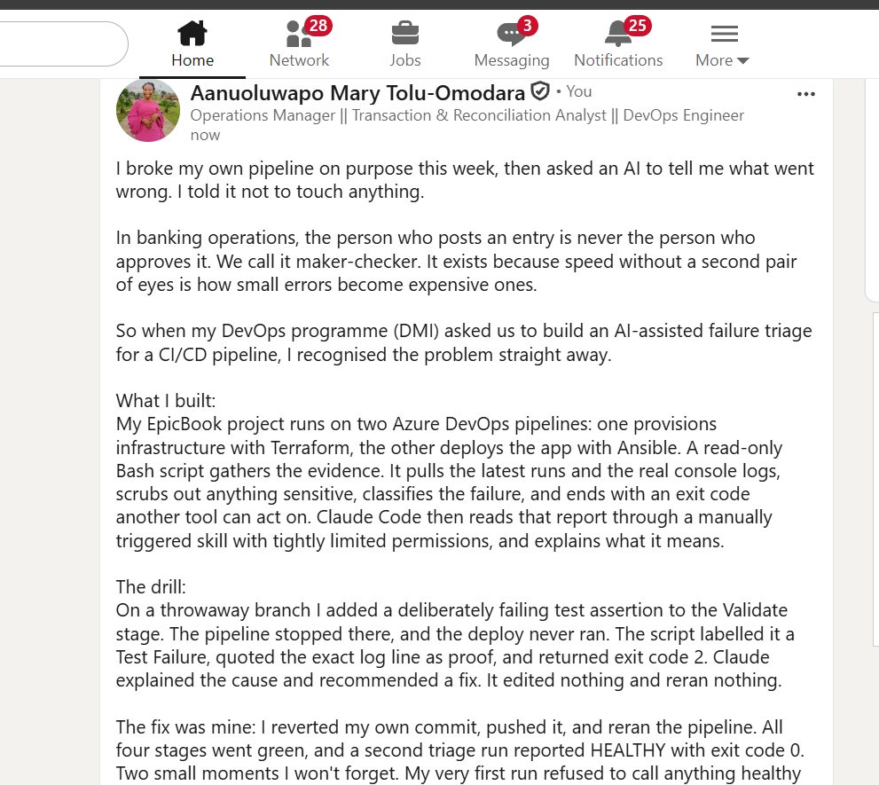

---

# Required Repository Files

Confirm that the following files are available in your repository:

* [ ] `CLAUDE.md`
* [ ] `pipeline-triage.sh`
* [ ] `.claude/skills/pipeline-triage/SKILL.md`
* [ ] `reports/incident-failure-report.txt`
* [ ] `reports/recovery-report.txt`

---

# Submission Instructions

* Complete all tasks in sequence.
* Include all 12 required screenshots.
* Answer every Notes question in your own words.
* Include your GitHub repository or fork URL.
* Include your public LinkedIn post URL.
* Ensure your Full Name appears in the required reports.
* Do not include raw logs containing sensitive information.
* Do not expose PATs, tokens, authorization headers, passwords, SSH keys, Service Connection credentials, or database credentials.

---

# Completion Checklist

* [ ] Both Azure DevOps pipelines were healthy before the drill.
* [ ] The supplied files were copied to the correct repository locations.
* [ ] Only the required student-specific placeholders were updated.
* [ ] `CLAUDE.md` contains the required context and safety rules.
* [ ] `pipeline-triage.sh` passed Bash syntax validation.
* [ ] The script has executable permission.
* [ ] The script uses read-only Azure DevOps operations.
* [ ] The script retrieves pipeline metadata and console logs.
* [ ] No token or password is stored in the script.
* [ ] The healthy baseline reported `HEALTHY` with exit code `0`.
* [ ] `/pipeline-triage` was invoked manually.
* [ ] The skill does not have broad Bash approval.
* [ ] The controlled failure affected only the Application Pipeline.
* [ ] The failure occurred before deployment changes were applied.
* [ ] The deliberate failure was not merged into `main`.
* [ ] The failed-state report was saved before applying the fix.
* [ ] Claude diagnosed the failure but did not apply the fix.
* [ ] The fix was reviewed and applied manually.
* [ ] The corrected Application Pipeline completed successfully.
* [ ] The recovery triage reported `HEALTHY` with exit code `0`.
* [ ] `incident-failure-report.txt` exists.
* [ ] `recovery-report.txt` exists.
* [ ] All Notes questions have been answered.
* [ ] All 12 screenshots have been added.
* [ ] The GitHub repository or fork URL has been included.
* [ ] The LinkedIn post is public.
* [ ] The LinkedIn post URL has been included.
* [ ] No sensitive information is exposed.

---

# Final Submission

**Full Name:** Aanuoluwapo Tolu-Omodara

**GitHub Repository or Fork URL:** https://github.com/PricelessMercy1

**LinkedIn Post URL:** https://lnkd.in/p/ehwKmx36

---

*This submission is part of the DevOps Micro Internship (DMI) — Agentic AI Track.*
